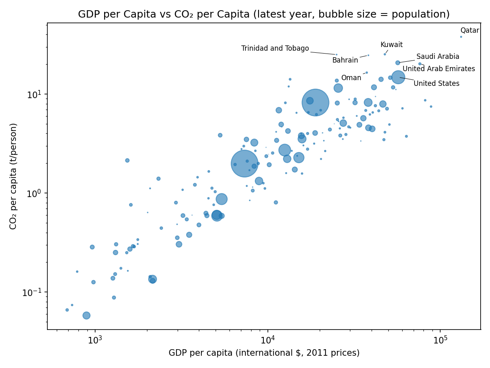
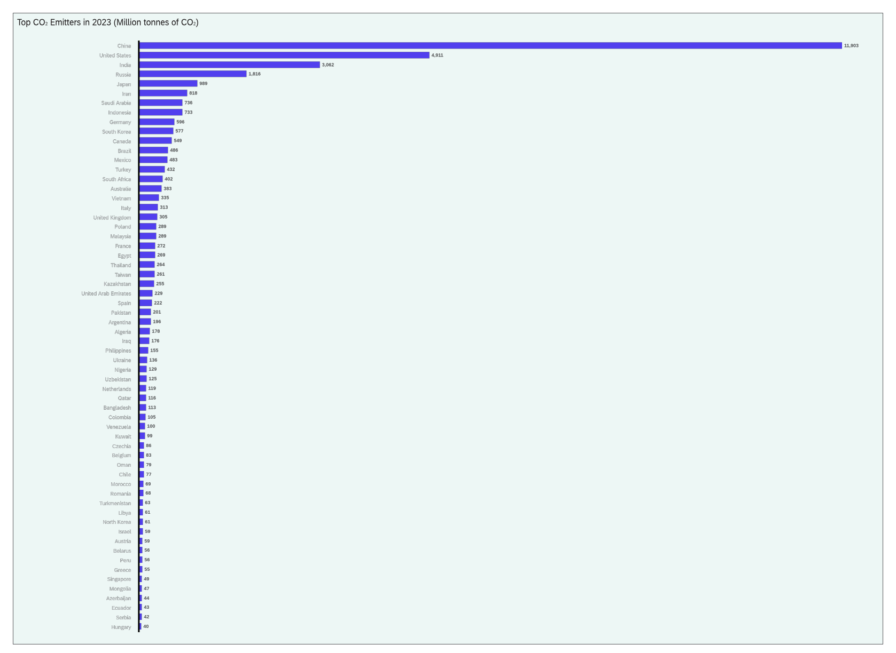
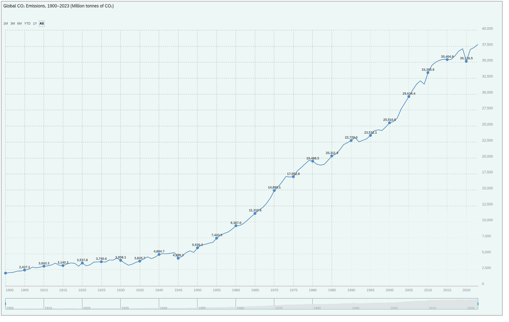

# CO₂ Emissions Analysis

Cleaning Our World in Data's CO₂ dataset and exploring how emissions per person relate to income across countries.

Individual course project for MIS 515 (Programming Data-Driven Applications) at San Diego State University, Fall 2025.

## Key findings

Data downloaded on 18 Oct 2026. The latest year with complete CO₂, GDP and population data is 2022, covering **164 countries**.

- **Income and emissions move together.** On the log scale, GDP per capita and CO₂ per capita correlate at **r = 0.91** (a strong association, not proof of cause).
- **Most countries emit little per person.** The median is 2.84 t per person and 71% of countries emit under 5 t.
- **The top emitters per person are mostly oil and gas producers:** Qatar (37.9 t), Kuwait (25.2 t), Trinidad and Tobago (25.1 t), Bahrain, Saudi Arabia, the UAE and Oman. The United States (14.8 t) is the only large economy in the top 8.



## Dashboard version (SAP Analytics Cloud)

For my individual final project in MIS 305 (Business Process & ERP Analytics), Fall 2025, I rebuilt this analysis as an interactive SAP Analytics Cloud story from cleaned OWID data. It has three charts: the top emitters in 2023, global emissions from 1900 to 2023, and the GDP vs CO₂ bubble chart for 2022.

- **Emissions are concentrated:** China, the United States and India lead by a wide margin, and the drop-off after the top few countries is steep.
- **The long-run trend is up:** global emissions climb steeply after about 1950, with short dips around 2009 and 2020.




The bubble chart is in `dashboard/co2_vs_gdp_2022.png`. The dashboard is interactive (hover details, time-range selector), so the screenshots show its default view.

## Data

[Our World in Data: CO₂ and Greenhouse Gas Emissions](https://github.com/owid/co2-data), published openly by Our World in Data (CC BY). GDP is in international dollars at 2011 prices (Maddison Project Database), and CO₂ per capita in tonnes per person (Global Carbon Budget).

The notebook downloads the latest version on every run, so counts can shift slightly when OWID updates the data (the original Fall 2025 run had 165 countries). The cleaned snapshot used for these results is in `data/processed/`.

## Approach

1. **Countries only:** kept rows with 3-letter ISO codes, which removes aggregates such as World and EU.
2. **Feature:** GDP per capita = GDP / population.
3. **One year per country:** each country's latest year with complete CO₂, GDP and population data.
4. **Charts:** histogram and KDE of CO₂ per capita, plus a log-log bubble chart sized by population, with the 8 highest emitters labeled using `adjustText` so labels don't overlap.

## What I would try next

- Compare continents (needs a country-to-continent mapping, since the dataset has no continent column)
- Track change over time instead of a single year
- Fit a regression line to find countries far above or below the trend

## Run it

```
pip install -r requirements.txt
jupyter notebook co2_emissions_analysis.ipynb
```

It also runs in Google Colab.

**Tools:** Python, pandas, NumPy, matplotlib, adjustText, SAP Analytics Cloud
